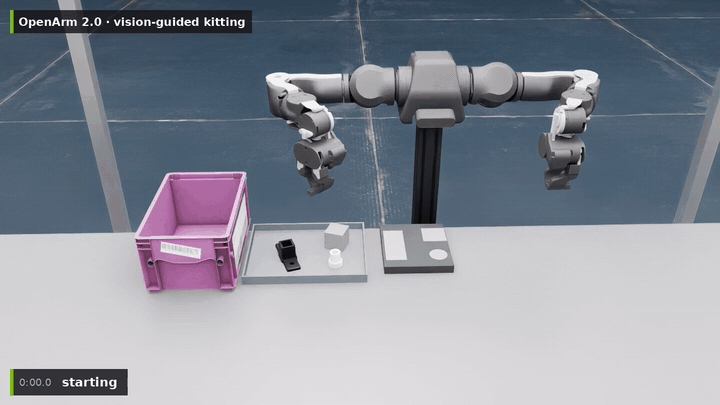
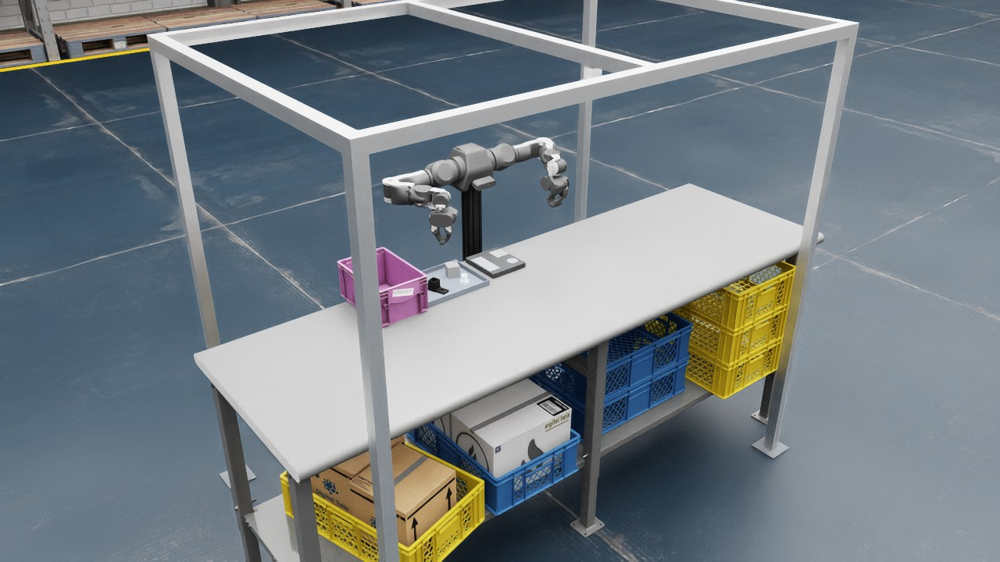
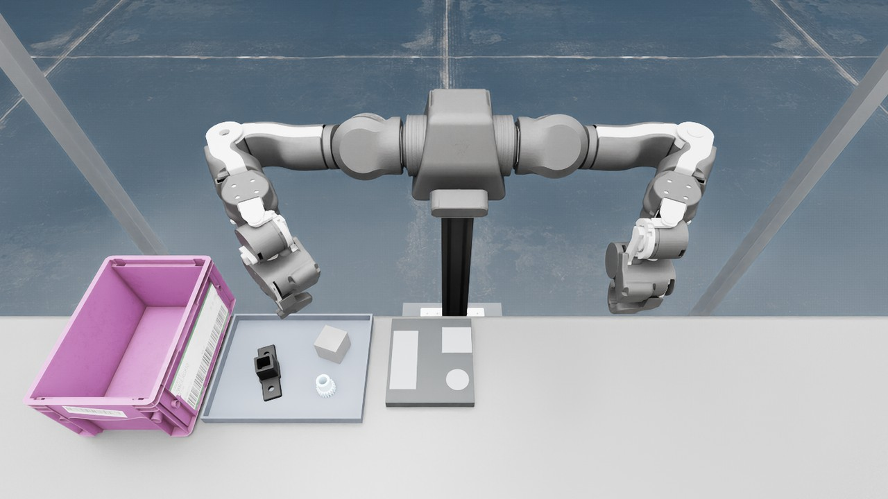
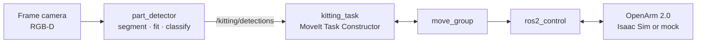

<h1 align="center">Vision-Guided Kitting with a Bimanual OpenArm 2.0</h1>

<p align="center">
  <b>RGB-D part detection · MoveIt Task Constructor pick and place · NVIDIA Isaac Sim</b>
</p>

<p align="center">
  <a href="https://github.com/ookkshirsagar/openarm-vision-kitting/actions/workflows/ci.yml"></a>
  
  
  
  
</p>

<p align="center">
  <a href="docs/media/openarm_kitting_demo.mp4">
    
  </a>
  <br/>
  <sub>▶ <a href="docs/media/openarm_kitting_demo.mp4">Full video</a>, real time. Inset: live part detections from the frame camera.</sub>
</p>

A camera finds loose machine parts in a tray, identifies each one and measures its pose. The OpenArm then places
one of each type into its pocket in a kit tray, and spare parts go into a reject bin.

<table width="100%">
  <tr>
    <td align="center" width="20%"><b>8 / 8</b><br/><sub>complete kits</sub></td>
    <td align="center" width="20%"><b>24 / 24</b><br/><sub>parts in their pocket</sub></td>
    <td align="center" width="20%"><b>4 mm</b><br/><sub>mean placement error</sub></td>
    <td align="center" width="20%"><b>100 %</b><br/><sub>parts detected and identified</sub></td>
    <td align="center" width="20%"><b>0.5 s</b><br/><sub>planning per part</sub></td>
  </tr>
</table>

## Results

Isaac Sim, eight random layouts of one connector, block and pinion. Each placement was checked against the
simulated part poses, not the task's own report.

| Metric | Connector | Block | Pinion |
|---|---|---|---|
| Parts placed in their pocket | 8 / 8 | 8 / 8 | 8 / 8 |
| Placement error, mean / max | 4.1 / 7.1 mm | 4.1 / 5.0 mm | 3.3 / 4.1 mm |
| Detections (10 frames per layout) | 80 / 80 | 100 / 100 | 110 / 110 |
| Wrong part type | 0 | 0 | 0 |
| Pose error, position / yaw (max) | 0.6 mm / 3.1° | 0.7 mm / 0.0° | 2.0 mm / round |

Cycle time 28.5 s per kit of three parts (27.2 – 31.5 s); no slips, failed executions or retries.

## The cell

<table>
  <tr>
    <td width="50%"></td>
    <td width="50%"></td>
  </tr>
  <tr>
    <td align="center"><sub>Packing bench, profile camera frame, KLT reject bin, parts tray and kit tray</sub></td>
    <td align="center"><sub>Frame camera (ZED X Mini) looking at the work area</sub></td>
  </tr>
</table>

| Parts | Size | Isaac Sim asset |
|---|---|---|
| T-slot profile connector | 114 × 38 × 39 mm | `Props/Flip_Stack` |
| Machined block | 47 mm cube | `Props/Blocks` |
| Pinion | ⌀32 × 38 mm | `Props/Factory` |

The whole layout is defined once in [`cell.yaml`](openarm_kitting_cell/config/cell.yaml), and both MoveIt's
collision model and the Isaac Sim scene are built from it.

## Architecture



| Stage | Implementation |
|---|---|
| **Perception** | Depth segmentation of the parts tray, an oriented box fitted to each part, type from measured size. No training data: a new part is one config entry. |
| **Grasping** | Grip height and width per part type; box parts gripped across their width in any symmetric turn |
| **Motion** | Pilz PTP transfers, straight-line approach, lift and lowering; OMPL fallback; one MTC task per part |
| **Kitting logic** | Needed parts first, nearest first; re-detection after each place confirms the pick, with automatic retry |
| **Simulation** | Isaac Sim 6 scene from NVIDIA assets, gravity-compensated arm, the gripper's hold mirrored from MoveIt ([`isaac_attach_bridge`](openarm_kitting/openarm_kitting/isaac_attach_bridge.py)) |

## Quick start

```bash
mkdir -p ~/openarm_ws/src && cd ~/openarm_ws/src
git clone https://github.com/ookkshirsagar/openarm-vision-kitting.git
vcs import < openarm-vision-kitting/dependencies.repos
cd .. && rosdep install --from-paths src --ignore-src -y
colcon build --symlink-install && source install/setup.bash
```

**Mock hardware** (no simulator):

```bash
ros2 launch openarm_kitting_moveit_config moveit.launch.py
ros2 launch openarm_kitting kitting.launch.py seed:=3
```

**NVIDIA Isaac Sim** (tested with 6.0.1 on an RTX 4090):

```bash
ISAAC_SIM=~/isaacsim-6.0.1 ./src/openarm-vision-kitting/isaac/run_scene.sh --seed 3
ros2 launch openarm_kitting_moveit_config moveit.launch.py hardware:=isaac
ros2 launch openarm_kitting kitting.launch.py hardware:=isaac
```

| Argument | Default | Description |
|---|---|---|
| `hardware` | `mock` | `mock` or `isaac` |
| `seed` / `parts` | `1` / `4` | random part layout, the same in mock and Isaac Sim |
| `segmentation` | `depth` | `depth`, or `ground_truth` (simulator masks) |

## Tests

```bash
colcon test --packages-select openarm_kitting_perception openarm_kitting && colcon test-result --verbose
```

| Package | Test |
|---|---|
| `openarm_kitting_perception` | Detection on rendered depth frames, every part type at random yaw: right type, within 4 mm and 4°; flake8 |
| `openarm_kitting` | End-to-end kitting on mock hardware: connector, block and pinion each into its pocket |

## Repository

```
openarm_kitting/                kitting task, attach bridge, launch, config, end-to-end test
openarm_kitting_perception/     part detector and detection library, unit tests
openarm_kitting_cell/           cell layout, robot and cell URDF
openarm_kitting_moveit_config/  SRDF, controllers, ros2_control, MoveIt launch
isaac/                          Isaac Sim scene and launcher
```

## Roadmap

- Logistics cell: parcels, labels, totes, with handover between the arms and bimanual lifts
- Depth noise model of a real stereo camera

## License

[Apache 2.0](LICENSE). The OpenArm and ZED descriptions are fetched by `dependencies.repos` and keep their own
licenses. Isaac Sim assets are NVIDIA's, referenced at run time and not part of this repository.
